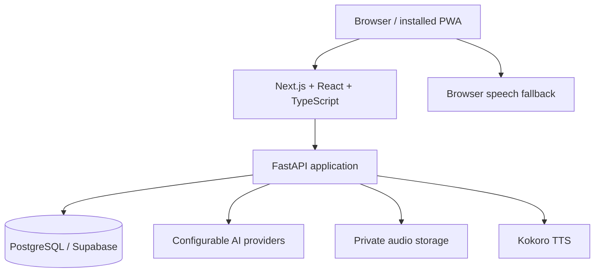

# Tutor and Professor

A full-stack study platform built with **Next.js, TypeScript, FastAPI and PostgreSQL**. It brings lessons, practice questions, spaced repetition and study planning into one account, with persisted sessions that let learners resume where they stopped.

AI generation extends the learning material; curated lessons and deterministic practice provide a path that does not require an AI provider call.

**Explore:** [Live application](https://tutorprofessor.vercel.app) · [Architecture](#architecture) · [Run locally](#run-locally) · [Engineering tradeoffs](#engineering-tradeoffs) · [Tests](#tests-and-verification) · [Code tour](#code-tour)

## At a glance

| Area | What the project demonstrates |
| --- | --- |
| Learning workflow | Lessons, review scheduling, quizzes, programming topics and a persisted study queue |
| Full-stack development | Typed React UI, Python API, relational models, migrations and reusable domain services |
| Account boundaries | Registration, approval, account/student ownership checks, admin controls and session revocation |
| AI integration | Configurable providers, validated generated content, credits and generation coordination |
| Product behavior | Progress, objectives, study plans, audio, installable PWA and recovery states |
| Verification | Python/Node checks and isolated Playwright flows against a local frontend and API |

The application includes SaaS foundations such as plans, entitlements, trials and usage records. **Paid checkout is not integrated with a payment gateway yet.**

## A short product walkthrough

1. Sign in and choose a learner profile. New accounts require administrator approval under the default `SIGNUP_MODE=manual` configuration.
2. Start a study session: the queue combines the day's lesson, due review and pending questions.
3. Answer a few cards, leave the page and return. The saved session supports continuing from the previous position.
4. Open objectives and study planning to connect daily work with a broader goal.
5. Review the account area for modules, learner settings and AI configuration; administrators manage account approval and AI authorization separately.

The deployed architecture documented by this repository uses Vercel for the web/API and Supabase PostgreSQL. The optional Kokoro voice service may depend on a local tunnel; browser speech provides a fallback. A local API is an alternative development mode, not a requirement of the hosted architecture.

## Architecture



| Layer | Implementation |
| --- | --- |
| Web | Next.js 15, React 19, TypeScript and Tailwind CSS |
| API | FastAPI, Pydantic, SQLModel and SQLAlchemy |
| Data | PostgreSQL; local Compose uses port `5433`; Alembic migrations through `database_bootstrap.py` |
| AI | Provider configuration and domain-specific generation/validation services |
| Audio | Kokoro-compatible TTS, browser speech fallback and optional private Supabase Storage cache |
| Deployment | Vercel web/API configuration, with Docker/VPS and local tunnel alternatives |

The browser calls the application API rather than querying Supabase tables directly. The bootstrap contains database access restrictions, while account authorization is enforced in API routes and helpers. Frontend route checks are not the security boundary.

### Learning and AI flows

- **Persisted study state:** lessons, review items and pending questions feed a queue; the API stores session progress so navigation and reloads do not need to rebuild the learner's position.
- **Practice without generation:** the curated English pack and [offline question service](apps/api/services/offline_question_service.py) produce deterministic questions from lesson material. Here, "offline" means no AI call; it does not mean the full application works without a network connection.
- **Validated generation:** services check generated structure and required content before persistence. For example, [flashcard validation](apps/api/services/ai_flashcard_service.py) rejects malformed batches and duplicate card fronts.
- **Concurrent generation:** selected read/check/insert paths use transaction-scoped PostgreSQL advisory locks; SQLite paths use process-local fallbacks. The lock lifetime and the surrounding transaction matter.
- **Account controls:** approval, enabled modules, AI authorization and credits are separate concepts. An approved account does not automatically receive unrestricted AI access.

## Engineering tradeoffs

These notes explain choices visible in the current code and their consequences. Linked comments and services record the rationale where available; possible replacements below are discussion points, not claims that comparative benchmarks were performed.

| Choice | Benefit | Cost or boundary; when to revisit |
| --- | --- | --- |
| Next.js frontend + separate FastAPI backend in one repository | TypeScript UI and Python domain services can evolve together while retaining distinct deployment units. | Contracts, authentication and cross-origin configuration cross two runtimes. Shared schemas or generated clients could reduce drift as the API grows. |
| Curated/deterministic practice alongside AI | Existing lessons remain useful without spending credits or depending on provider availability. [The service explains this decision](apps/api/services/offline_question_service.py). | Template-derived questions offer less variety; generated material still needs validation and editorial review. Use AI where the extra variation improves the learning task. |
| Persisted sessions and review state | Learners can resume across reloads and devices; progress is a server-side product concept. | More state transitions and ownership checks must remain consistent. Session-resume and account-isolation tests are especially valuable here. |
| PostgreSQL coordination for selected generation paths and rate limits | Shared state can coordinate multiple API instances without introducing another service. See [rate limiting](apps/api/services/rate_limit.py) and `_generation_lock` in [main.py](apps/api/main.py). | Locks and counter writes add database work. The limiter uses a weighted-window approximation and allows a request if its database check fails; SQLite fallbacks are process-local. These behaviors need consideration when scaling or tightening abuse controls. |
| Serverless API with migrations kept outside request startup | Avoiding schema work on Vercel startup reduces cold-start work and keeps DDL out of ordinary requests. | Deployment must apply migrations in advance, and long AI operations must respect function duration limits. A worker/job service is a possible next step for work that must outlive a request. |
| Plans defined in code, with entitlements separated from checkout | Plan changes are versioned and reviewable; the free product works without a gateway. This rationale is documented in [billing_service.py](apps/api/services/billing_service.py). | Price/limit changes require deployment. The checkout provider integration and its reconciliation flows remain future work. |
| Small PWA cache that bypasses API routes | Static assets and an offline page improve installation/recovery without caching account data or stale backend-discovery responses. | Study actions still need the API; this is not a fully offline learning client. See [the service worker](apps/web/public/sw.js). |

## Run locally

**Tooling:** Python 3.11+, Node.js 22.18+, pnpm 10 and Docker with Compose. The Node/pnpm versions match the documented E2E environment. Use a local development database.

```bash
git clone https://github.com/helberjf/tutor-professor.git
cd tutor-professor
```

### Windows launcher

```powershell
.\start-project.cmd
```

The launcher prepares example environment files when missing, checks dependencies, starts the local PostgreSQL service and launches the API/web processes. Review [the launcher](scripts/start-project.ps1) and configure `apps/api/.env` for your local account before using admin or external-provider features.

### Manual setup

The commands below use a POSIX shell. On Windows, activate the virtual environment with `.venv\Scripts\Activate.ps1` and use `Copy-Item` for the file copies.

```bash
python -m venv .venv
source .venv/bin/activate
python -m pip install -r apps/api/requirements.txt
cp apps/api/.env.example apps/api/.env
cp apps/web/.env.example apps/web/.env.local
docker compose up -d db
```

Set `ADMIN_EMAIL` in `apps/api/.env` to the local administrator account you will create. Keep `APP_ENV=development` for this local setup; use a generated, private `SESSION_SECRET` for a deployed environment. The API rejects placeholder secrets outside development.

Run migrations, then start the API:

```bash
cd apps/api
python database_bootstrap.py
python -m uvicorn main:app --host 127.0.0.1 --port 8001 --reload
```

In another terminal, with the virtual environment active, create the administrator from the repository root. The script prompts for a password when one is not supplied:

```bash
python scripts/create-admin-user.py --email admin@example.com
```

Use the same email in `ADMIN_EMAIL`. To load the checked-in static lesson content into the local database:

```bash
python scripts/init_db.py
```

Start the frontend in another terminal:

```bash
cd apps/web
pnpm install --frozen-lockfile
pnpm dev
```

| Service | Local address |
| --- | --- |
| Web | http://localhost:3000 |
| API health | http://localhost:8001/health |
| API documentation | http://localhost:8001/docs |
| PostgreSQL | `127.0.0.1:5433` |

Use the local administrator to approve new accounts. AI keys, SMTP, OAuth and Kokoro configuration are optional integrations with their own setup requirements; an empty key does not provide a live AI service.

<details>
<summary>Environment and alternative deployment paths</summary>

Start with [apps/api/.env.example](apps/api/.env.example) and [apps/web/.env.example](apps/web/.env.example). Important settings include:

| Setting | Purpose |
| --- | --- |
| `DATABASE_URL` | Local PostgreSQL or the chosen deployment connection |
| `SESSION_SECRET` | Session protection; unique secret outside development |
| `ADMIN_EMAIL` | Account recognized as administrator |
| `CORS_ALLOWED_ORIGINS` | Allowed frontend origins |
| `NEXT_PUBLIC_API_BASE_URL` | Frontend API location for local development |
| `GEMINI_API_KEY` / provider settings | Optional generated content |
| `TTS_PROVIDER`, `KOKORO_URL` | Optional voice service |
| `PARENT_COOKIE_SECURE`, `PARENT_COOKIE_SAMESITE` | Cookie behavior appropriate to the deployment |

The [Vercel + Supabase guide](docs/deploy-vercel-supabase.md) covers runtime versus migration database connections, audio storage and serverless behavior. Run migrations through the documented session-compatible connection before deploying code that requires them. The [VPS guide](docs/DEPLOY-VPS.md) covers container deployment.

For the alternative local API/tunnel workflow, `.\start-project.cmd -WithTunnel` or `.\ativar-tudo.cmd` starts the relevant local services. The `/connect` page and runtime backend state support changing tunnel URLs without a frontend redeploy. See [the tunnel guide](docs/cloudflare-tunnel.md) and [Portuguese walkthrough](guia.md).

The legacy SQLite-to-PostgreSQL migration utility is [scripts/migrate_sqlite_to_postgres.py](scripts/migrate_sqlite_to_postgres.py); it is not required for a fresh PostgreSQL installation.

</details>

## Tests and verification

The [testing guide](docs/testing.md) documents isolated Playwright execution, synthetic accounts, Codegen and CI. The E2E runner starts its own local frontend/API and disposable SQLite database, with external network access blocked. It does not use real AI, email, OAuth or payment services.

From the repository root, with the backend virtual environment active:

```bash
python -m pip install -r scripts/e2e/requirements.txt
python scripts/e2e/run_legacy.py
```

Then, from `apps/web`:

```bash
pnpm install --frozen-lockfile
pnpm exec playwright install chromium
pnpm typecheck
pnpm test:e2e:safety
pnpm test:e2e
```

Do not start `e2e:env` before `test:e2e`: the runner owns its environment and refuses occupied test ports. If the Python executable is not discovered automatically, configure `E2E_PYTHON` as described in the testing guide.

Additional entry points include `pnpm test:e2e:mobile`, `pnpm test:e2e:build`, `pnpm test:e2e:report` and `pnpm e2e:codegen`. Mobile mode is Chromium device emulation, not a physical-device result.

Useful evidence to inspect:

- [Tenant isolation checks](scripts/test_tenant_isolation.py) and [account approval checks](scripts/test_admin_account_approval.py).
- [Study session behavior](scripts/test_study_session_flow.py) and [study resume tests](scripts/test_study_resume.py).
- [AI flashcard validation tests](scripts/test_ai_flashcard_service.py).
- [Playwright suites](apps/web/e2e), [CI](.github/workflows/ci.yml) and [E2E workflow](.github/workflows/e2e.yml).
- [Recorded testing results](docs/testing-results.md), with the scope and date of each recorded run.

SQLite-based E2E tests do not validate PostgreSQL advisory locking, hosted database access policy or real provider behavior. Those require targeted integration checks. Test files and workflow definitions describe coverage; refer to actual run results for pass/fail evidence.

## Current limitations and next improvements

- **Payments:** plans, trials, entitlements, usage and a signed webhook handler exist; the paid checkout path still returns a not-configured response. A gateway integration and reconciliation tests are needed before accepting payments.
- **Authentication deployment:** the repository currently documents a Google sign-in callback-cookie problem between separate `.vercel.app` domains. Email/password login is the documented alternative; custom-domain or redirect-code handling needs deployment verification.
- **Long-running AI work:** serverless requests have duration limits. Selected workflows checkpoint state, but durable background execution is a separate design concern.
- **Maintainability:** `apps/api/main.py` contains many routes and cross-cutting concerns. Extracting cohesive routers while preserving ownership checks and tests would make changes easier to review.
- **Operational evidence:** generation cost records are estimates. Provider token usage, PostgreSQL concurrency tests, load measurements and restore drills would strengthen the operational story.
- **Documentation:** some older architecture/setup notes still describe the earlier SQLite and tunnel-only design. The current stack, example files and deployment configuration take precedence.

## Code tour

For a focused technical review, follow one user action through these files:

1. [Study queue service](apps/api/services/study_queue_service.py) and [frontend queue rules](apps/web/src/lib/question-queue.ts) — what is due, pending or mastered.
2. [Models](apps/api/models/database.py) and [API routes](apps/api/main.py) — persisted sessions, ownership and state transitions.
3. [Flashcard validation](apps/api/services/ai_flashcard_service.py) and [deterministic question generation](apps/api/services/offline_question_service.py) — generated versus derived practice.
4. [Runtime backend selection](apps/web/src/lib/api-config.ts) and [runtime state](apps/web/src/lib/runtime-backend.ts) — deployment configuration and stale connection recovery.
5. [Database bootstrap](apps/api/database_bootstrap.py), [rate limiter](apps/api/services/rate_limit.py) and [billing domain](apps/api/services/billing_service.py) — operational and product tradeoffs.

## More documentation

- [SaaS implementation status](docs/TODO-SAAS.md) and [operations](docs/saas-operacao.md).
- [Vercel + Supabase deployment](docs/deploy-vercel-supabase.md) and [Docker/VPS deployment](docs/DEPLOY-VPS.md).
- [Testing guide](docs/testing.md) and [recorded results](docs/testing-results.md).
- [Feature analysis](docs/analise-melhorias-funcionalidades.md).
- [Privacy](docs/privacidade.md) and [terms](docs/termos.md) drafts, awaiting legal review.

Several detailed guides are in Portuguese; this README is the English entry point.

## License

MIT, as stated by the project.
